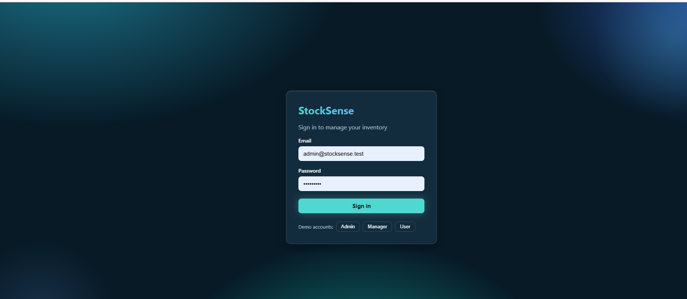
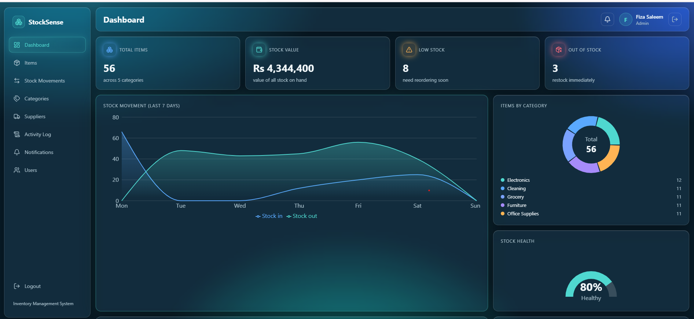
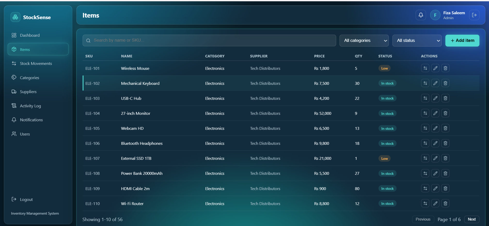
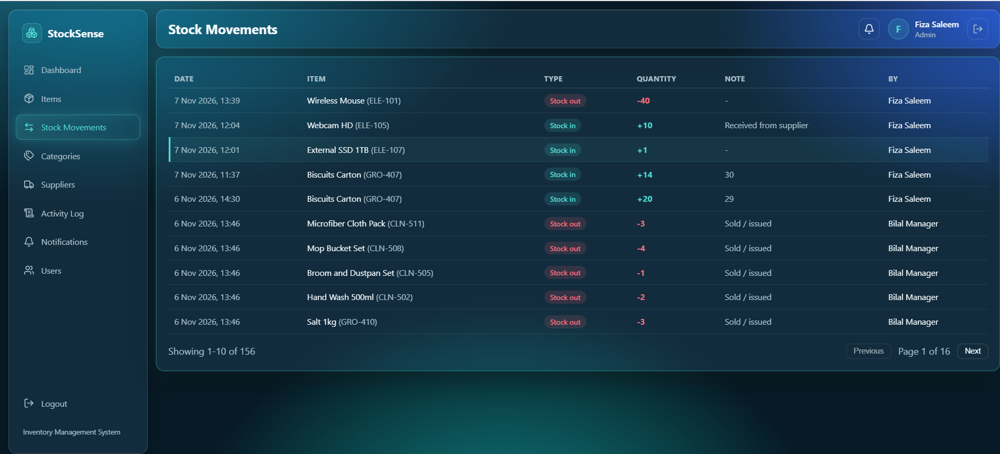
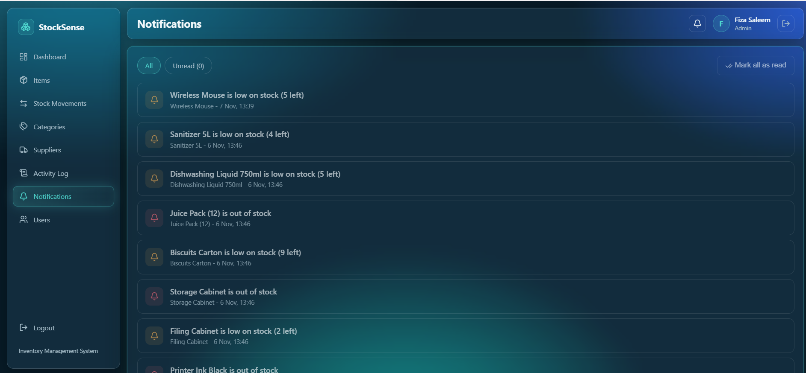
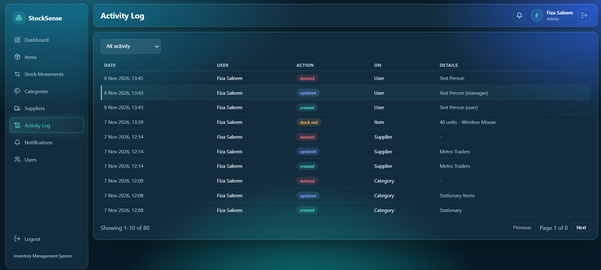
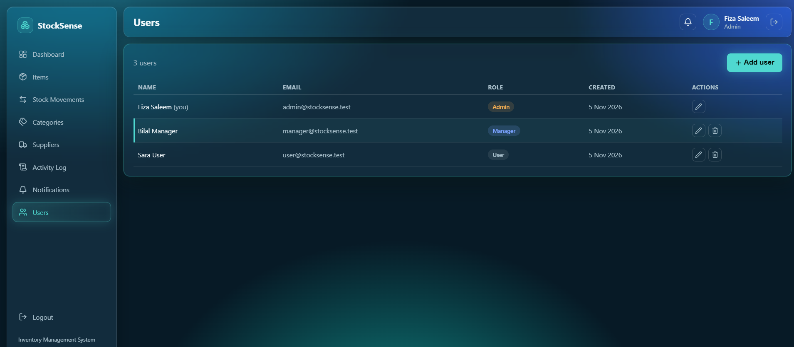
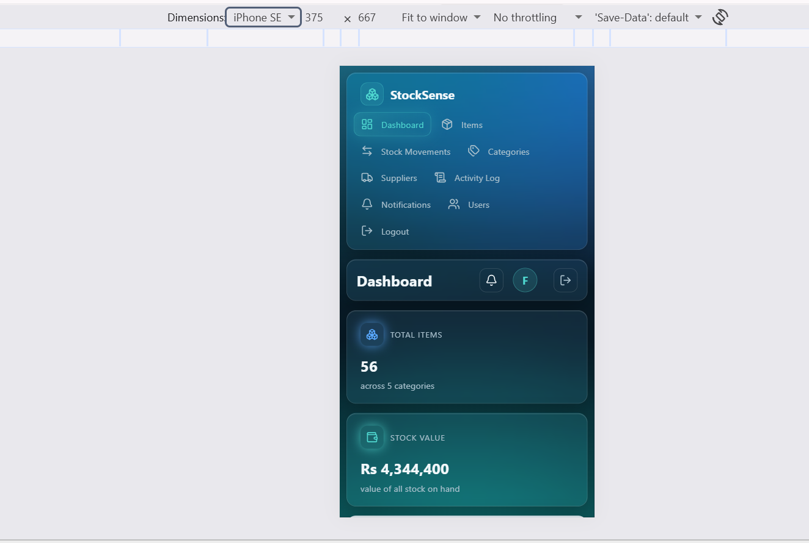

# StockSense - Inventory Management System

A full-stack inventory management web app built for the Codneura Full Stack Developer Internship.

**Author:** Fiza Saleem - fiza.cm26.9214@gmail.com - GitHub: [Fiza-insights](https://github.com/Fiza-insights)

## Features

- Secure login (JWT + bcrypt) with 3 roles: Admin, Manager, User
- Dashboard with summary cards and charts
- Items: add, edit, delete, search, filter, sort, pagination
- Stock In / Stock Out with full history
- Categories and Suppliers management
- Low stock and out of stock notifications
- Activity log (who did what and when)
- User management (admin only)
- Works on phone and desktop

## Tech Stack

- Backend: Node.js, Express 5, SQLite (better-sqlite3), JWT, bcryptjs
- Frontend: React, Vite, React Router, Recharts, lucide-react

## Setup

Requirements: Node.js 22 or newer.

### 1. Backend (start this first)

Create a file `backend/.env` with one line: `JWT_SECRET=any-long-random-text`

Then run:

    cd backend
    npm install
    node seed.js
    node server.js

The API runs on http://localhost:5000

### 2. Frontend (in a new terminal)

    cd frontend
    npm install
    npm run dev

Open http://localhost:5173

## Demo Accounts

| Role | Email | Password |
|---|---|---|
| Admin | admin@stocksense.test | Admin@123 |
| Manager | manager@stocksense.test | Manager@123 |
| User | user@stocksense.test | User@123 |

`node seed.js` adds dummy data: 3 users, 5 categories, 5 suppliers, 55 items and a week of stock history. It is safe to run again.

## Roles

| Feature | Admin | Manager | User |
|---|---|---|---|
| View dashboard, items, movements, categories, suppliers | Yes | Yes | Yes |
| Stock In / Out | Yes | Yes | Yes |
| Add / edit items, categories, suppliers | Yes | Yes | No |
| Delete items, categories, suppliers | Yes | No | No |
| Activity log | Yes | Yes | No |
| Manage users | Yes | No | No |

## Database

Tables (see `backend/schema.sql`): users, categories, suppliers, items, stock_movements, activity_log, notifications.

## Screenshots

| | |
|---|---|
|  |  |
|  |  |
|  |  |
|  |  |

## Credits

- No external images are used. Icons are from [lucide-react](https://lucide.dev) (ISC license) and charts from [Recharts](https://recharts.org) (MIT license).
- All data is dummy seed data.

## Development Notes

I built this project with the help of an AI assistant (Claude). I ran and tested every feature myself and I can explain how each part of the code works.
